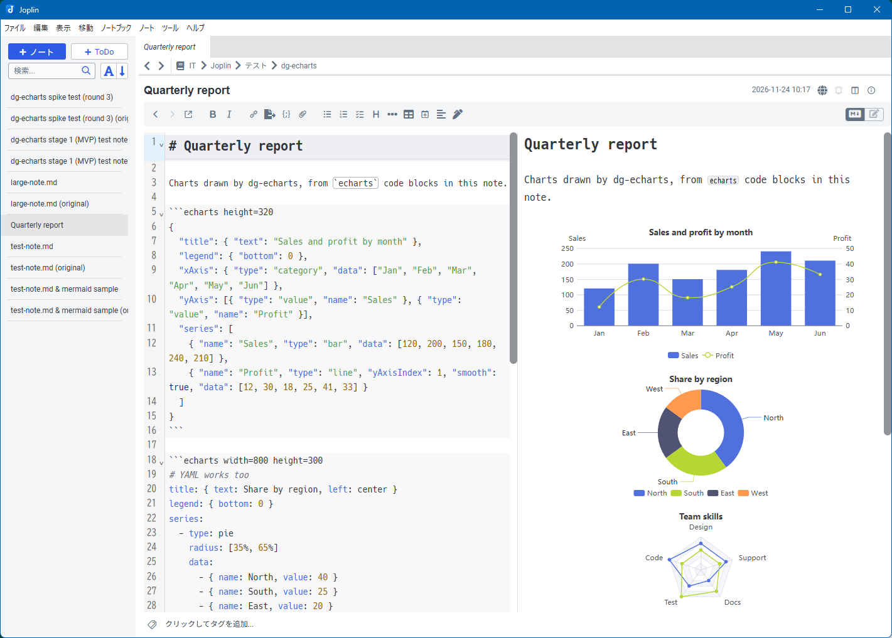
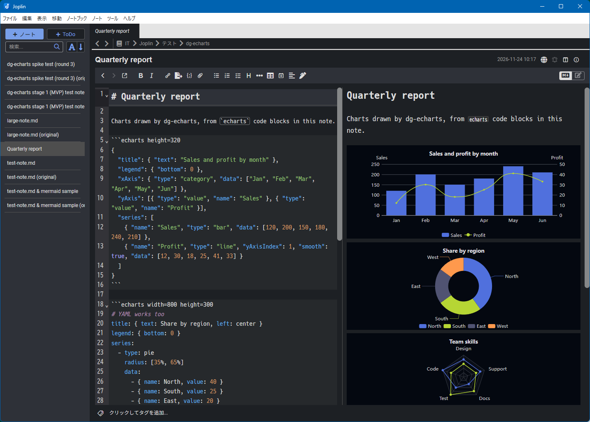

# dg-echarts

Render [Apache ECharts](https://echarts.apache.org/) charts in [Joplin](https://joplinapp.org/) notes, with the rendering engine bundled inside the plugin.

> **Bundled engine, no network access.**
> The Apache ECharts rendering engine is bundled inside this plugin.
> No external server is used, and the plugin makes no network requests. It does
> not load external images written in a chart either. Your charts are rendered
> locally, and the plugin never sends your notes anywhere. It works fully offline.

This statement covers what the plugin itself does. Joplin's own features, such as synchronisation, are not part of the plugin.

日本語：[このページの後半](#日本語)（[README.ja.md](README.ja.md) と同じ内容）

| Light theme | Dark theme |
| ----------- | ---------- |
|  |  |


## Features

- Renders the ECharts options (`option`) written in JSON or YAML in `echarts` code blocks, in the note viewer, in the Rich Text editor, and in PDF and HTML exports.
- Uses the official ECharts 6.1.0 ([`echarts`](https://www.npmjs.com/package/echarts)), bundled unchanged. Bar, line, pie, scatter, radar, heatmap, treemap, sankey, gauge, funnel, graph (network) and the other ECharts charts work, except maps.
- Charts are drawn as SVG. No script is needed to show them, so exported HTML files contain them as they are.
- Follows Joplin's light and dark themes automatically, or a theme fixed in the settings.
- Shows JSON and YAML syntax errors with the line number and an excerpt. Common mistakes (an unknown chart type, a bar chart without axes...) get a clear message.
- Charts are drawn at the setting width (800 px by default) and shrink in a narrower pane; they are never stretched. The font size can follow the note text, and a smallest font size can be set.
- A toolbar on each chart to copy or save it (SVG or PNG), or copy its source.
- Colours the JSON / YAML of ECharts blocks in the Markdown editor.
- The user interface (settings screen, messages, toolbar and so on) is translated with gettext, and the main languages are already translated. It follows Joplin's display language, and so do the month and day names of the charts' date axes. Supported languages (11): English, Japanese, Chinese (Simplified and Traditional), Korean, German, French, Spanish, Italian, Portuguese (Brazil) and Russian.

## Installation

Open Joplin's plugin screen (Tools → Options → Plugins on Windows and Linux, Joplin → Settings → Plugins on macOS), search for **dg-echarts**, and install it.

You can also download the `.jpl` file from [GitHub Releases](https://github.com/akiratamcat/joplin-plugin-dg-echarts/releases) and install it with "Install from file" on the plugin screen. To build the plugin yourself, see [CONTRIBUTING.md](CONTRIBUTING.md).

Requirements: Joplin 3.1 or later, desktop. Tested with the latest stable version of Joplin.

## Usage

Write the ECharts `option` in JSON in a fenced code block with the language `echarts`:

````markdown
```echarts
{
  "title": { "text": "Sales per month" },
  "xAxis": { "type": "category", "data": ["Jan", "Feb", "Mar"] },
  "yAxis": {},
  "series": [{ "type": "bar", "data": [120, 200, 150] }]
}
```
````

YAML works too (a block whose first non-blank character is not `{` is read as YAML). It allows comments and needs few quotes:

````markdown
```echarts
# Sales per month
xAxis: { type: category, data: [Jan, Feb, Mar] }
yAxis: {}
series:
  - type: bar
    data: [120, 200, 150]
```
````

See the [ECharts option reference](https://echarts.apache.org/en/option.html) and the [ECharts examples](https://echarts.apache.org/examples/). The examples are JavaScript: rewrite their `option` in JSON or YAML, without the functions.

### Block options

Options can follow the language name:

````markdown
```echarts theme=dark height=300 width=600 align=left
{ "series": [{ "type": "pie", "data": [{ "name": "A", "value": 1 }, { "name": "B", "value": 2 }] }] }
```
````

| Option   | Values                      | Meaning                                                                                       |
| -------- | --------------------------- | --------------------------------------------------------------------------------------------- |
| `theme`  | `light` / `dark` / `none`   | Colours of this chart. `none` keeps the ECharts default; the plugin changes neither the background nor the font sizes |
| `height` | 100–2000 (px)               | Height of the chart (default: the setting, 400)                                               |
| `width`  | 200–4000 (px)               | Width the chart is drawn at (default: the setting, 800). It shrinks in a narrower pane        |
| `align`  | `left` / `center` / `right` | Position of the chart (default: `center`)                                                     |

Other Markdown tools ignore these options, so the notes stay portable.

## Limitations

- **Functions**: the input is never run as JavaScript, so functions cannot be written (`formatter` functions, `renderItem` of `custom` series...). A `formatter` can be a string template such as `"{b}: {c}"`.
- **Maps**: maps (`geo`, series type `map`) are not available. They are shown as an error.
- **Images**: neither external images nor `data:` images are loaded (`image://` symbols, image patterns, `graphic` images, legend icons...). When some are removed, a note is shown under the chart.
- **`url()` in colours**: a CSS `url()` (an image fill) in a colour or background value is not loaded, and that part is not painted. A chart whose `emphasis` colours hold such a value or CSS has no hover highlight. Gradients work with ECharts gradient objects (`type: "linear"` and so on). CSS added to font values and the like is removed where it could load a file.
- **Interaction**: charts are static SVG, so tooltips, zoom, legend clicks and other interactions do not work. `tooltip`, `toolbox` and link settings are removed silently.
- **Printing**: Joplin's print does not show plugin charts (a Joplin issue). Export to PDF and print the PDF instead.
- **Force layout graphs**: graphs with `layout: "force"` are small with the ECharts defaults. Make `force.edgeLength` and `force.repulsion` larger.
- **Narrow panes**: when a chart shrinks, its texts shrink too (the smallest font size applies to the chart at the width it is drawn at).
- **Labels in exports**: when a note is exported to PDF or HTML, the text border of labels is removed, so that text copied from a PDF is not doubled.
- **Other plugins**: do not use dg-echarts together with another plugin that renders `echarts` code blocks. Which plugin renders a block is not defined, and the result can break.
- **Rich Text editor**: when you edit the source in Joplin's edit dialog and press OK, Joplin rewrites the fence with three backticks. This is how Joplin handles all code blocks, including Mermaid.
- **Mobile**: desktop only for now.

## Reporting problems

Please use the [Issues](https://github.com/akiratamcat/joplin-plugin-dg-echarts/issues) page for bugs, questions and requests. For security problems, see [SECURITY.md](SECURITY.md). To build the plugin or contribute, see [CONTRIBUTING.md](CONTRIBUTING.md).

## License

dg-echarts is released under the [MIT License](LICENSE).

The plugin package also contains the third-party software below. The full license texts are in [THIRD_PARTY_NOTICES.md](THIRD_PARTY_NOTICES.md), which is also included in the plugin package. The same list is shown on the plugin's settings screen in Joplin.

| Name | Version | License | Website |
| ---- | ------- | ------- | ------- |
| Apache ECharts (`echarts`), the rendering engine | 6.1.0 | Apache-2.0 | <https://echarts.apache.org/> |
| Parts of d3 (inside ECharts) | as bundled in ECharts 6.1.0 | BSD-3-Clause | <https://github.com/d3/d3> |
| ZRender (inside ECharts) | 6.1.0 | BSD-3-Clause | <https://github.com/ecomfe/zrender> |
| tslib (inside ECharts) | 2.3.0 | 0BSD | <https://github.com/microsoft/tslib> |
| DOMPurify (cleans the SVG output) | 3.4.17 | Apache-2.0 (dual-licensed Apache-2.0 / MPL-2.0) | <https://github.com/cure53/DOMPurify> |
| regenerator-runtime (inside DOMPurify) | as bundled in DOMPurify 3.4.17 | MIT | <https://github.com/facebook/regenerator> |
| YAML (`yaml`), reads YAML | 2.9.1 | ISC | <https://eemeli.org/yaml/> |

Apache ECharts and ECharts are trademarks of the Apache Software Foundation. This plugin is not affiliated with the Apache Software Foundation.

## AI-assisted development

This plugin is developed with extensive use of generative AI (Anthropic's Claude).
A large share of the design documents, source code, tests, documentation, and
translations was produced with Claude. The maintainer reviews each output step by
step, decides what to adopt, and makes corrections as needed. The maintainer is
responsible for the final content. If you find a problem, please report it on the
Issues page.

---

## 日本語

<!-- The Japanese half below is generated from README.ja.md by npm run docs. Edit README.ja.md, not this part. -->
<!-- ja:start -->

[Joplin](https://joplinapp.org/) のノートで [Apache ECharts](https://echarts.apache.org/) のグラフを表示するプラグインです。描画エンジンをプラグインに内蔵しています。

> **描画エンジン内蔵・外部通信なし**
> Apache ECharts の描画エンジンをプラグインに内蔵しています。
> 外部のサーバーは使わず、プラグインはネットワーク通信を一切行いません。グラフに書いた外部の画像の URL も読み込みません。
> グラフは手元で描画され、ノートの内容が本プラグインによって外部に送られることはありません。オフラインでも動作します。

これは本プラグイン自身の動作についての説明です。Joplin 本体の同期などの機能は含みません。

| Light のテーマ | Dark のテーマ |
| -------------- | ------------- |
|  |  |


### 機能

- `echarts` のコードブロックに JSON か YAML で書いた ECharts の設定（`option`）を、グラフとして表示します。ノートビューア、リッチテキストエディタ、PDF と HTML のエクスポートで表示されます。
- 公式の ECharts 6.1.0（[`echarts`](https://www.npmjs.com/package/echarts)）を、手を加えずに内蔵しています。棒、折れ線、円、散布図、レーダー、ヒートマップ、ツリーマップ、サンキー、ゲージ、ファネル、グラフ（ネットワーク図）など、地図を除く ECharts のグラフが使えます。
- グラフは SVG で描かれます。描画にスクリプトは要らないので、エクスポートした HTML にもそのまま入ります。
- Joplin の明るいテーマと暗いテーマに自動で合わせます。設定で固定することもできます。
- JSON と YAML の構文の誤りを、行番号と該当行の抜粋つきで表示します。よくある誤り（未知のグラフの種類、軸のない棒グラフなど）も、分かりやすい文で知らせます。
- グラフは設定の幅（既定 800px）で描き、狭いペインでは縮めて表示します。引き伸ばすことはありません。ノートの本文に合わせた文字サイズや、最小の文字サイズを設定できます。
- 各グラフのツールバーで、グラフを SVG か PNG でコピー・保存したり、ソースをコピーしたりできます。
- Markdown エディタで、ECharts のブロックの JSON / YAML を色分けします。
- 画面の文字（設定画面、メッセージ、ツールバーなど）は gettext の仕組みで翻訳しており、主要な言語に翻訳済みです。Joplin の表示言語に合わせて切り替わります。グラフの日付の軸の月や曜日の名前も、同じ言語になります。対応している言語は、英語、日本語、中国語（簡体字・繁体字）、韓国語、ドイツ語、フランス語、スペイン語、イタリア語、ポルトガル語（ブラジル）、ロシア語の11言語です。

### インストール

Joplin のプラグインの画面（Windows と Linux はツール → オプション → プラグイン、macOS は Joplin → 設定 → プラグイン）で **dg-echarts** を検索して、インストールしてください。

[GitHub Releases](https://github.com/akiratamcat/joplin-plugin-dg-echarts/releases) から `.jpl` ファイルをダウンロードして、プラグインの画面の「ファイルからインストール」で入れることもできます。自分でビルドする場合は [CONTRIBUTING.ja.md](CONTRIBUTING.ja.md) をご覧ください。

動作環境：Joplin 3.1 以降のデスクトップ版。動作確認は Joplin の最新の安定版で行っています。

### 使い方

言語名を `echarts` にしたコードブロックに、ECharts の `option` を JSON で書きます。

````markdown
```echarts
{
  "title": { "text": "月別の売上" },
  "xAxis": { "type": "category", "data": ["1月", "2月", "3月"] },
  "yAxis": {},
  "series": [{ "type": "bar", "data": [120, 200, 150] }]
}
```
````

YAML でも書けます（最初の空白でない文字が `{` でなければ YAML として読みます）。コメントが書け、引用符をほとんど省けます。

````markdown
```echarts
# 月別の売上
xAxis: { type: category, data: [1月, 2月, 3月] }
yAxis: {}
series:
  - type: bar
    data: [120, 200, 150]
```
````

書き方は [ECharts の設定の説明](https://echarts.apache.org/en/option.html) と [ECharts の例](https://echarts.apache.org/examples/) をご覧ください。例の `option` は JavaScript なので、関数の部分を除いて JSON か YAML に書き直して使います。

#### ブロックのオプション

言語名の後ろにオプションを書けます。

````markdown
```echarts theme=dark height=300 width=600 align=left
{ "series": [{ "type": "pie", "data": [{ "name": "A", "value": 1 }, { "name": "B", "value": 2 }] }] }
```
````

| オプション | 値                          | 意味                                                                                  |
| ---------- | --------------------------- | ------------------------------------------------------------------------------------- |
| `theme`    | `light` / `dark` / `none`   | このグラフの配色。`none` は ECharts の既定のままで、プラグインは背景も文字サイズも変えません |
| `height`   | 100〜2000（px）             | グラフの高さ（既定は設定の値。400）                                                   |
| `width`    | 200〜4000（px）             | グラフを描く幅（既定は設定の値。800）。狭いペインでは縮めて表示します                 |
| `align`    | `left` / `center` / `right` | グラフの位置（既定は `center`）                                                       |

ほかの Markdown のツールはこれらのオプションを無視するので、ノートの互換性は保たれます。

### 制限事項

- **関数**：入力を JavaScript として実行しないので、関数は書けません（`formatter` の関数、`custom` 系列の `renderItem` など）。`formatter` は `"{b}: {c}"` のような文字列のテンプレートなら使えます。
- **地図**：地図（`geo`、系列の種類 `map`）は使えません。エラーとして表示します。
- **画像**：外部の画像も `data:` の画像も読み込みません（`image://` のシンボル、画像のパターン、`graphic` の画像、凡例のアイコンなど）。取り除いた場合は、グラフの下に注意を出します。
- **色の `url()`**：色や背景の値に CSS の `url()`（画像の塗り）を書いても読み込まず、その部分は塗りません。強調表示の色にそうした値や CSS を書いたグラフは、マウスを乗せたときの強調表示をしません。グラデーションは、ECharts のグラデーションの指定（`type: "linear"` など）で使えます。文字の書体などの値に CSS を書き足しても、外部を読む部分は取り除きます。
- **操作**：グラフは静的な SVG なので、ツールチップ、ズーム、凡例のクリックなどの操作はできません。`tooltip`、`toolbox`、リンクの設定は、何も言わずに取り除きます。
- **印刷**：Joplin の印刷では、プラグインのグラフが表示されません（Joplin の問題です）。PDF にエクスポートしてから印刷してください。
- **力学モデルのグラフ**：`layout: "force"` のグラフは、ECharts の既定では小さく描かれます。`force.edgeLength` と `force.repulsion` を大きくしてください。
- **狭いペイン**：グラフが縮んで表示されると、文字も小さくなります（最小の文字サイズは、描いた幅で表示したときの大きさです）。
- **エクスポートのラベル**：PDF や HTML にエクスポートするときは、ラベルの文字の縁取りを外します（PDF から文字をコピーしたときに、文字が二重にならないようにするため）。
- **ほかのプラグインとの併用**：`echarts` のコードブロックを表示するほかのプラグインとは、一緒に使わないでください。どちらのプラグインが表示するかが決まらず、表示が崩れることがあります。
- **リッチテキストエディタ**：Joplin の編集画面でソースを書き換えて OK を押すと、Joplin がフェンスを ```` ``` ```` に書き直します。Joplin のすべてのコードブロック（Mermaid を含む）と同じ動きです。
- **モバイル**：今のところデスクトップ版だけに対応しています。

### 問題の報告

不具合、質問、要望は [Issues](https://github.com/akiratamcat/joplin-plugin-dg-echarts/issues) でお知らせください。セキュリティの問題は [SECURITY.ja.md](SECURITY.ja.md) をご覧ください。プラグインのビルドや開発への参加については [CONTRIBUTING.ja.md](CONTRIBUTING.ja.md) をご覧ください。

### ライセンス

dg-echarts は [MIT ライセンス](LICENSE) で公開しています。

プラグインのパッケージには、次の外部のソフトウェアも含まれています。ライセンスの全文は [THIRD_PARTY_NOTICES.ja.md](THIRD_PARTY_NOTICES.ja.md)（英語版は [THIRD_PARTY_NOTICES.md](THIRD_PARTY_NOTICES.md)）にあり、プラグインのパッケージにも同梱しています。同じ一覧は、Joplin の本プラグインの設定画面にも表示されます。

| 名称 | バージョン | ライセンス | 公式サイト |
| ---- | ---------- | ---------- | ---------- |
| Apache ECharts（`echarts`）。描画エンジン | 6.1.0 | Apache-2.0 | <https://echarts.apache.org/> |
| d3 の一部（ECharts に含まれる） | ECharts 6.1.0 に含まれるもの | BSD-3-Clause | <https://github.com/d3/d3> |
| ZRender（ECharts に含まれる） | 6.1.0 | BSD-3-Clause | <https://github.com/ecomfe/zrender> |
| tslib（ECharts に含まれる） | 2.3.0 | 0BSD | <https://github.com/microsoft/tslib> |
| DOMPurify（SVG の出力の無害化） | 3.4.17 | Apache-2.0（Apache-2.0 と MPL-2.0 のデュアルライセンス） | <https://github.com/cure53/DOMPurify> |
| regenerator-runtime（DOMPurify に含まれる） | DOMPurify 3.4.17 に含まれるもの | MIT | <https://github.com/facebook/regenerator> |
| YAML（`yaml`）。YAML の読み取り | 2.9.1 | ISC | <https://eemeli.org/yaml/> |

`LICENSE` は法的な文面のため、英語の原文だけを置いています。

Apache ECharts、ECharts は、Apache Software Foundation の商標です。本プラグインは Apache Software Foundation とは関係がありません。

### 生成 AI の利用について

本プラグインは、生成 AI（Anthropic の Claude）を全面的に用いて開発しています。
設計書、ソースコード、テスト、ドキュメント、翻訳のかなりの部分を Claude で作成しました。
作者が Claude の出力を逐次確認し、採用するかどうかの判断と修正を行っており、
最終的な内容の責任は作者が負います。問題を見つけた場合は Issue でお知らせください。

<!-- ja:end -->
